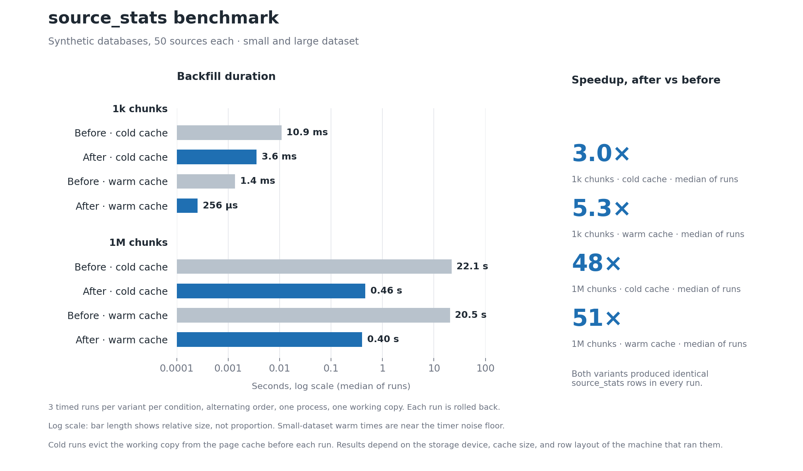

# source-stats-backfill

## Question

How long does the `source_stats` backfill take when its embedded counts come from a sum over `knowledge_embedding_coverage` (after) instead of a per-chunk embedding count (before)? Measured on a small and a large synthetic dataset, under cold and warm cache.

## Result



- **1k chunks, cold cache:** before 10.9 ms, after 3.6 ms, speedup 3.0x (median of 3 runs).
- **1k chunks, warm cache:** before 1.4 ms, after 256 µs, speedup 5.3x (median of 3 runs).
- **1M chunks, cold cache:** before 22.1 s, after 0.46 s, speedup 47.6x (median of 3 runs).
- **1M chunks, warm cache:** before 20.5 s, after 0.40 s, speedup 51.1x (median of 3 runs).

Both variants wrote identical `source_stats` rows in every run.

## Method

- **Harness.** `harness.py` runs both variants in one process against one working copy of the database. Order alternates between runs. Each run is rolled back, so the working copy never changes.
- **Variants.** *before* uses correlated scalar subqueries per source. *after* uses `LEFT JOIN` to grouped aggregates, with embedded counts summed from `knowledge_embedding_coverage`. The SQL for both is in `harness.py`.
- **Cold condition.** The working copy is evicted from the page cache before every timed run with `posix_fadvise(POSIX_FADV_DONTNEED)`. This needs a Unix that provides it.
- **Warm condition.** One untimed warm-up run per variant, then timed runs with the cache populated.
- **Correctness.** Each variant's resulting `source_stats` rows are hashed, and the harness fails if the two hashes differ.
- **Isolation.** Runs were sequential. Nothing else read or wrote the same disk during the timed runs.
- **Runs.** 3 timed runs per variant per condition. The chart shows medians. `results.json` keeps every run.

## Datasets

Both datasets are generated by `generate_dataset.py` with a fixed seed. They match bpx-rag's table layout for the columns the backfill reads, and they are not copies of any real database.

- **1k chunks:** 1,000 chunks, 100 files, 50 sources. Database 4,304,896 bytes.
- **1M chunks:** 1,000,000 chunks, 10,000 files, 50 sources. Database 4,205,481,984 bytes.

Embedding bytes are random, 768 float32 dimensions, drawn from a pool of 256 blobs. Coverage rows are computed from the embedding rows, which is the state the coverage triggers produce for a fully embedded database with one model.

## Environment

- Operating system: Linux (x86_64).
- Python 3.12.3, SQLite 3.45.1.
- Logical CPUs: 12.
- Storage device and memory size were not standardized. Cold results depend on both.

## Caveats

- **Row layout matters.** In these synthetic databases, rows for each source are stored together, so embedding reads are mostly sequential. A database whose rows are scattered across the file by sync order will make the before variant's per-row probes random reads. Expect a larger cold gap there.
- **Small-dataset warm times are near the timer noise floor.** The 1k warm figures are a few milliseconds. Their ratio is less reliable than the 1M figures.
- **Cold results depend on storage.** Faster storage narrows the cold gap. The warm gap is CPU-bound and more stable.
- **One machine.** Results have not been reproduced on other hardware.
- **Coverage dependency.** The after variant assumes `knowledge_embedding_coverage` matches the embedding rows. The generator computes it that way, and the correctness check compares the output of both variants on the same copy.

## Reproduce

```sh
cd benchmarks/source-stats-backfill
python3 generate_dataset.py --sources 50 --files-per-source 2 --chunks-per-file 10 --out small.db
python3 generate_dataset.py --sources 50 --files-per-source 200 --chunks-per-file 100 --out large.db
python3 harness.py --db small.db --cache cold --runs 3 --out small-cold.json
python3 harness.py --db small.db --cache warm --runs 3 --out small-warm.json
python3 harness.py --db large.db --cache cold --runs 3 --out large-cold.json
python3 harness.py --db large.db --cache warm --runs 3 --out large-warm.json
python3 combine.py small=small-cold.json,small-warm.json large=large-cold.json,large-warm.json
python3 make_chart.py
```
